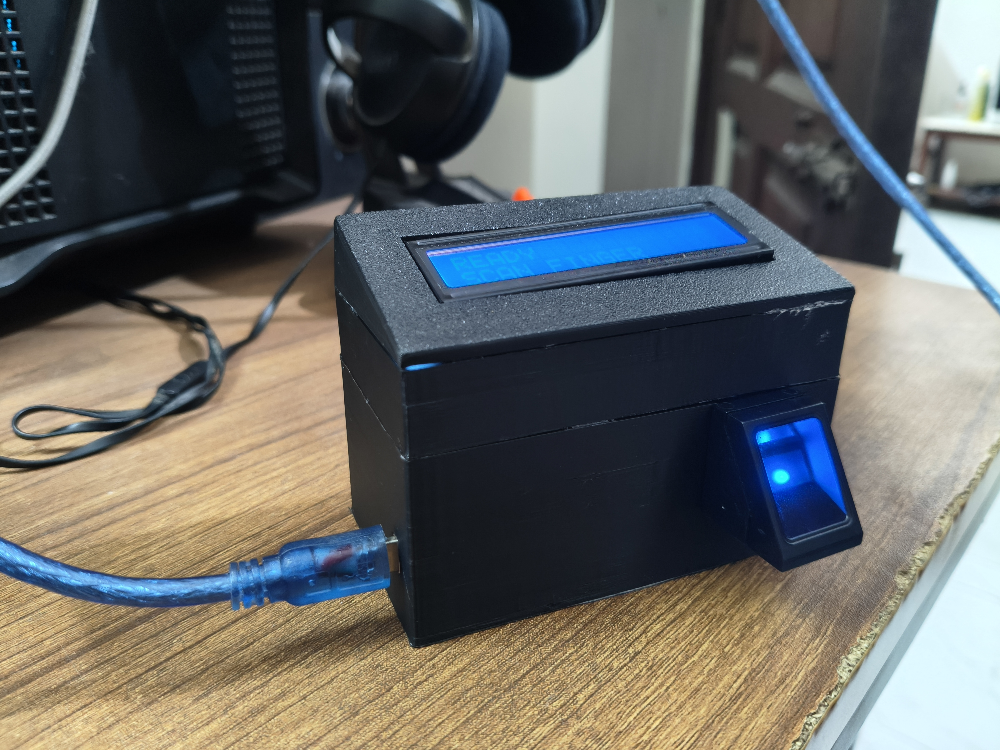
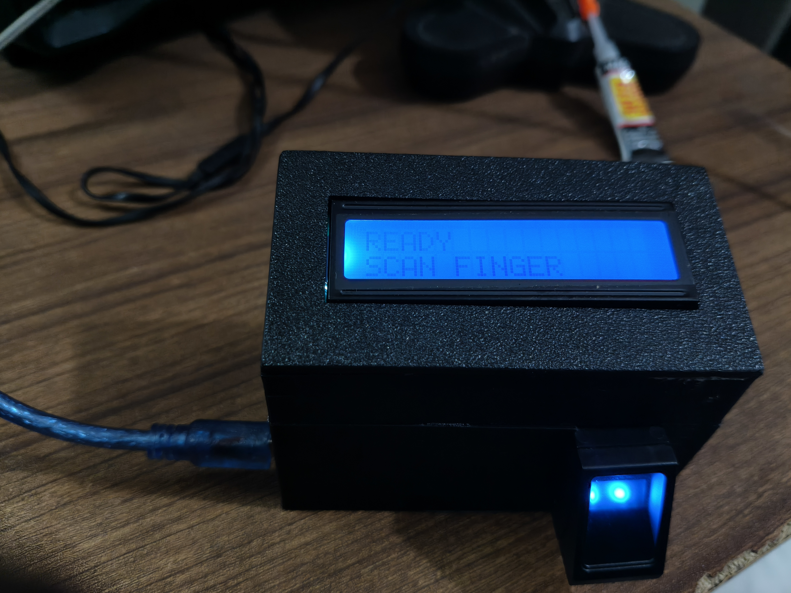
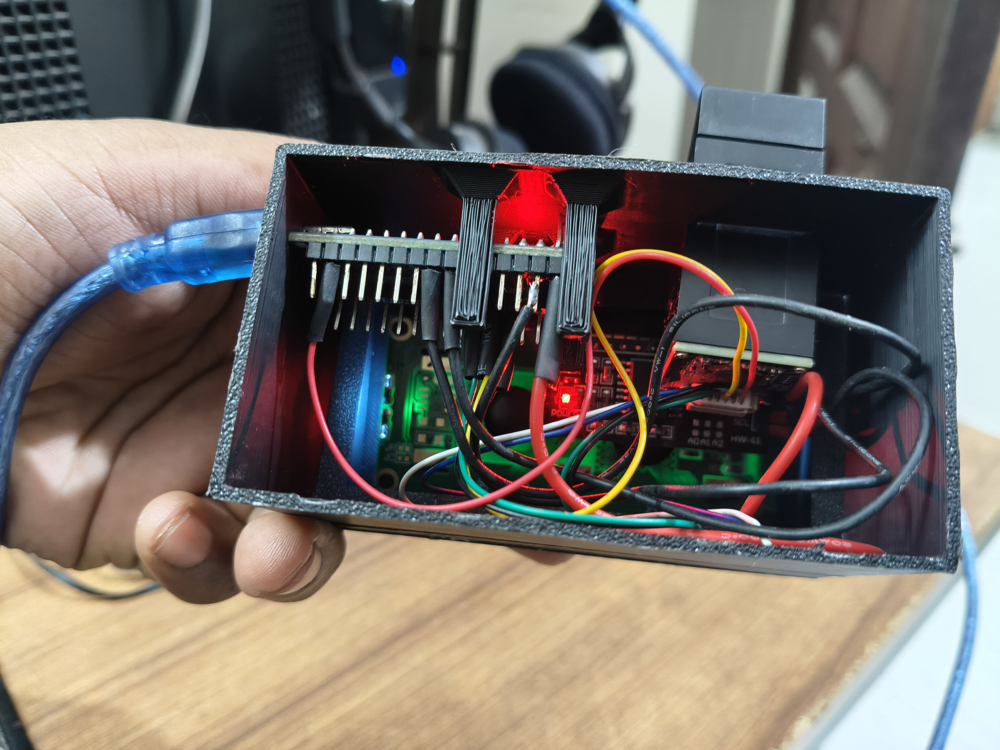
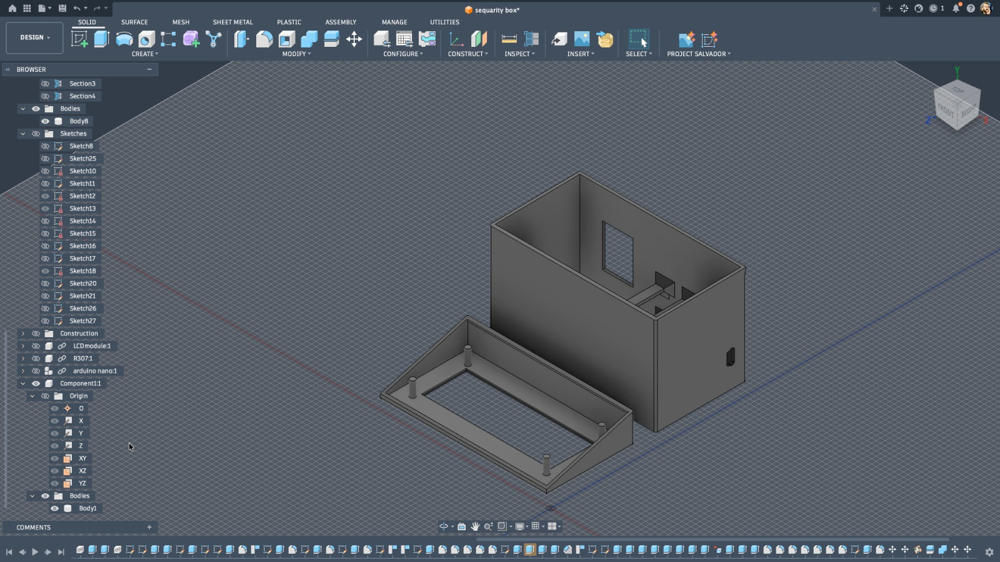

# Fingerprint Access Control

An Arduino fingerprint access system built into a 3D-printed box. Staff fingers are registered from the Serial Monitor, their names are saved in EEPROM, and a 16x2 I2C LCD (mounted upside down, so the text is drawn flipped 180°) shows who was granted access.



| Top view | Inside wiring | Enclosure CAD |
|---|---|---|
|  |  |  |

## Project structure

```
fingerprint-access-control/
├── firmware/
│   ├── FingerEnroll/              # Step 1: register / list / delete staff over Serial Monitor
│   │   ├── FingerEnroll.ino
│   │   └── common.h
│   └── FingerAccess/              # Step 2: scan finger -> ACCESS GRANTED + name / DENIED
│       ├── FingerAccess.ino
│       └── common.h
├── docs/
│   ├── 3d-models/                 # STL files for the printed enclosure
│   │   ├── enclosure-1-top-lid.stl        # sloped lid with the LCD window
│   │   ├── enclosure-2-middle-body.stl
│   │   └── enclosure-3-lower-body.stl     # holds the Arduino, USB port and sensor
│   └── images/                    # Photos of the finished device and the CAD design
└── README.md
```

`common.h` holds the shared EEPROM staff storage and the flipped-LCD code.
**Keep both copies identical**: if you edit one, copy it to the other folder. (Arduino needs each sketch in a folder with the same name as its `.ino` file, so the sketch folders must not be renamed.)

---

## How to make it

### 1. Parts

| Part | Qty | Notes |
|---|---|---|
| Arduino Nano (or Uno) | 1 | ATmega328P, 1 KB EEPROM |
| Fingerprint sensor R307 / AS608 | 1 | 57600 baud, UART |
| 16x2 LCD with I2C backpack | 1 | Address `0x27` (some are `0x3F`) |
| USB cable (Mini-USB for Nano) | 1 | Power + programming |
| Jumper wires, heat-shrink | — | |
| 3D-printed enclosure | 3 parts | See `docs/3d-models/` |

### 2. Print the enclosure

Print the three STL files in [docs/3d-models/](docs/3d-models/):

| File | Part |
|---|---|
| `enclosure-1-top-lid.stl` | Sloped top lid with the LCD window |
| `enclosure-2-middle-body.stl` | Middle section |
| `enclosure-3-lower-body.stl` | Base: Arduino, USB opening and fingerprint sensor slot |

Suggested settings: PLA, 0.2 mm layer height, 20% infill, 3 walls. Supports may be needed for the LCD window and the sensor slot.

### 3. Wiring

| Module | Pin | Arduino |
|---|---|---|
| Fingerprint | TX | D2 |
| Fingerprint | RX | D3 |
| Fingerprint | VCC / GND | 5V (or 3.3V, check your sensor) / GND |
| LCD I2C | SDA | A4 |
| LCD I2C | SCL | A5 |
| LCD I2C | VCC / GND | 5V / GND |

```
 Fingerprint sensor          Arduino Nano            LCD I2C backpack
 ┌──────────────┐           ┌────────────┐           ┌──────────────┐
 │ TX ──────────┼──────────►│ D2      A4 │◄──────────┼── SDA        │
 │ RX ◄─────────┼───────────│ D3      A5 │◄──────────┼── SCL        │
 │ VCC ─────────┼───────────│ 5V      5V │───────────┼── VCC        │
 │ GND ─────────┼───────────│ GND    GND │───────────┼── GND        │
 └──────────────┘           └────────────┘           └──────────────┘
```

### 4. Assemble

1. Mount the Arduino in the lower body with its USB port lined up with the side opening.
2. Push the fingerprint sensor into its slot on the front of the lower body.
3. Fix the LCD into the lid window. It goes in **upside down** — the code flips the text so it reads correctly.
4. Wire everything as in the table above and insulate joints with heat-shrink.
5. Stack lower body → middle body → lid.

### 5. Install the software

1. Install the [Arduino IDE](https://www.arduino.cc/en/software).
2. From **Tools → Manage Libraries**, install:
   - `Adafruit Fingerprint Sensor Library`
   - `LiquidCrystal I2C` (Frank de Brabander)
3. Select **Tools → Board → Arduino Nano** (or Uno) and the right **Port**.
   For cheap Nano clones, choose **Processor → ATmega328P (Old Bootloader)** if upload fails.

---

## How to use it

### Step 1 — Register staff (`FingerEnroll`)

1. Open [firmware/FingerEnroll/FingerEnroll.ino](firmware/FingerEnroll/FingerEnroll.ino) and upload it.
2. Open the Serial Monitor at **9600 baud**, line ending **Newline**. The LCD shows `ENROLL MODE`.
3. Type a command and press Enter:

| Command | Action |
|---|---|
| `e` | Enroll: enter an ID (1-50), the staff name, then place the same finger twice |
| `l` | List all saved staff |
| `d` | Delete one staff member by ID |
| `x` | Delete everyone (type `YES` to confirm) |

Example session:

```
> e
Enter ID (1-50):
> 1
Enter staff name (max 14 chars, A-Z 0-9 space):
> RAHIM
Place finger on sensor...
Remove finger.
Place the SAME finger again...
SUCCESS: staff saved.
```

The same finger cannot be saved under two different IDs.

### Step 2 — Run access control (`FingerAccess`)

1. Open [firmware/FingerAccess/FingerAccess.ino](firmware/FingerAccess/FingerAccess.ino) and upload it. Names stay in EEPROM, so nothing is lost.
2. The LCD shows `READY / SCAN FINGER`.
3. Place a finger on the sensor:
   - Registered → `<NAME> / GRANTED`
   - Not registered → `ACCESS / DENIED`
4. Remove the finger; the screen returns to `READY` after about 2.5 seconds.

Every scan is also printed to the Serial Monitor (9600 baud), so a PC can log entries.

To add or remove staff later, upload `FingerEnroll` again, make the changes, then upload `FingerAccess` back.

---

## Flipped LCD limits

The HD44780 LCD has no rotate command, so each character is redrawn upside down as a custom character.

- Max **8 different characters per screen**, counting both lines together
- `S N I O H X Z 0 8` and space look the same upside down, so they don't count toward the 8
- Uppercase `A-Z`, `0-9` and space only (no `!` or `:`)
- Staff names: max 14 characters. The enroll sketch rejects names that won't fit; use a short name or nickname.

## Storage

| Item | Value |
|---|---|
| Max staff | 50 (IDs 1-50) |
| EEPROM per record | 16 bytes (marker + name) |
| EEPROM used | 800 / 1024 bytes |

## Troubleshooting

| Problem | Fix |
|---|---|
| LCD backlight on but no text | Turn the contrast potentiometer on the I2C backpack; or change `0x27` to `0x3F` in both `common.h` files |
| `SENSOR ERROR / CHECK WIRING` | Swap the sensor TX/RX wires (TX → D2, RX → D3) and check power |
| Upload fails on Nano | Select **ATmega328P (Old Bootloader)** |
| Serial Monitor shows garbage | Set baud to **9600** |
| "Too many different letters" | The name needs more than 8 non-symmetric letters; use a shorter name |
